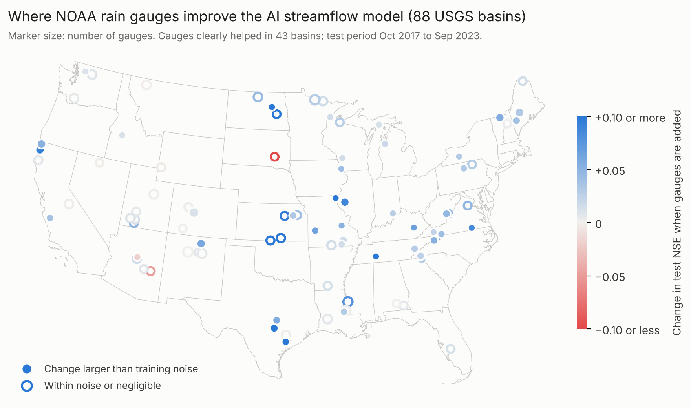

# multigauge

[](https://doi.org/10.5281/zenodo.23986756)

**How much do local rain gauges add to a state-of-the-art AI streamflow model, and which gauges matter?**

`multigauge` is an open-source Python package and web dashboard that answers this for any U.S. watershed.
It starts from a Long Short-Term Memory (LSTM) network pre-trained on hundreds of basins, fine-tunes it on your
basin, adds your rain gauges as extra inputs, and measures the gain against conceptual and single-basin
baselines, with prediction intervals, sub-basin routing, multi-day forecasts and a physics-guided hybrid model.

**Live dashboard:** https://multigauge-hydro.streamlit.app ·
**Run it on any USGS gauge (free GPU):** [Open in Colab](https://colab.research.google.com/github/ogunbajoadeyinka/multigauge-hydro/blob/main/notebooks/run_your_basin.ipynb)

## Why

- LSTMs trained on **many basins** are far more accurate than single-basin models
  ([Kratzert et al., 2019](https://hess.copernicus.org/articles/23/5089/2019/); [2024](https://hess.copernicus.org/preprints/hess-2023-275/hess-2023-275.pdf)),
  and **fine-tuning** a pre-trained model adapts it to a local basin ([Ryd & Nearing, 2025](https://arxiv.org/abs/2504.12559)).
- Local gauge networks (state mesonets, agency gauges) are not part of national AI models. Agencies need to know
  **whether, and where, their gauges improve predictions** to justify installing and maintaining them.
- multigauge measures that value on top of a strong pre-trained model, so a gauge does not look useful merely
  because the baseline model is weak.

## What it does

| Phase | Capability |
|---|---|
| 1 | Pre-trained multi-basin LSTM (CAMELS-US) with probabilistic (CMAL) output; fine-tuning on your basin; local gauges added as inputs (single, average, Voronoi-weighted, all); comparison against GR4J, a single-basin LSTM and the un-tuned model; gauge ranking by permutation importance and ablation |
| 2 | Sub-basin LSTMs with routing to the outlet, by learned gamma travel-time hydrographs or a graph attention network; where flood flow comes from; gauge value per sub-basin; where a new gauge would help most |
| 3 | 1–7 day probabilistic forecasts (hindcast/forecast LSTM with recent-flow error correction); differentiable HBV hybrid (δHBV) and LSTM + δHBV ensemble; daily scheduled forecasts with GitHub Actions |

Outputs: NSE, KGE, RMSE, percent bias, peak-flow error, CRPS and 90 % interval coverage per model; gauge-value
tables; hydrographs with prediction intervals; maps; forecast fan charts; and a self-contained HTML report.

## Validation: five U.S. basins and an 88-basin national survey

The CAMELS-US model was tested in detail on five USGS basins it never saw (Oklahoma, Iowa, Georgia, Texas,
Maryland) and in a national survey of 88 basins covering all 18 U.S. hydrologic regions (2017–2023 test
period). Full results, with limitations, are in [docs/validation_report.md](docs/validation_report.md) and on
the dashboard under "Real basins".



- **Nationally, rain gauges help in most basins.** Adding NOAA gauges raised test NSE in 80 % of the 88 basins
  (median +0.021, Wilcoxon p = 3 × 10⁻⁹). The gain is concentrated in rain-dominated basins (median +0.039,
  positive in 93 %) and absent in snow-dominated western basins (median −0.001).

- **Check gauge timing first.** Most NOAA cooperative gauges log morning readings under the next day. multigauge
  detects this and shifts those gauges; without the fix, gauge–Daymet correlation was 0.27–0.65, and 0.90–0.98 after.
- **Spatial detail matters even more than gauges in large basins.** Splitting three large basins (Iowa, Flint,
  La Moine rivers) into four routed sub-basins raised test NSE by **+0.12 to +0.21** with gridded weather alone;
  once sub-basins were resolved, NOAA gauges added nothing measurable (+0.001 to +0.006, three seeds each).
- **No model wins everywhere:** δHBV, GR4J and the local LSTM each win somewhere; the LSTM + δHBV ensemble is never the worst.
- **Forecasts** (Iowa and Flint rivers): NSE 0.67–0.84 at 7 days ahead, against 0.46 and −0.53 for persistence.

## Install

```bash
pip install "multigauge-hydro[app,download]"          # once released on PyPI
# or from source
git clone https://github.com/ogunbajoadeyinka/multigauge-hydro
cd multigauge-hydro && pip install -e ".[dev]"
```

A CPU is enough to fine-tune and run studies. Pre-training on CAMELS-US needs a GPU: use
[`notebooks/pretrain_camels.ipynb`](notebooks/pretrain_camels.ipynb) on Google Colab (about 1 hour).

## Quick start

```bash
multigauge demo demo_basin/
multigauge study demo_basin/ -o results/ --model demo-synthetic --seeds 1
# open results/report.html
```

For your own basin, put these in a folder (details in [docs/data_format.md](docs/data_format.md)):
`rainfall.csv` (gauges), `stations.csv`, `streamflow.csv`, `boundary.geojson` and `forcings.csv`
(basin-average Daymet weather, which multigauge can download):

```bash
multigauge usgs 07316000 2000-01-01 2020-12-31 -o my_basin/streamflow.csv
multigauge daymet my_basin/                    # writes forcings.csv from the boundary
multigauge study my_basin/ -o results/ --model camels-us --seeds 3 --ablation
```

```python
import multigauge as mg

data = mg.BasinData.from_folder("my_basin/")
base = mg.load_pretrained("camels-us")
res = mg.run_study(data, base, mg.StudyConfig(n_seeds=3))
print(res.summary.xs("test", level="period")[["NSE", "KGE", "CRPS"]])
print(res.gauge_value)                       # what the gauges add
mg.write_report(res, data, "report.html")
```

Sub-basins ([docs/subbasins.md](docs/subbasins.md)) and forecasts ([docs/forecasting.md](docs/forecasting.md)):

```bash
multigauge zones my_basin/ -n 4                # or supply your own sub-basins
multigauge subbasins my_basin/ --routing gamma
multigauge forecast-setup my_basin/ --site 07316000 --out forecasts/my_basin
multigauge forecast-run forecasts/
```

## Models compared in a study

| Name | Description |
|---|---|
| `gr4j` | GR4J conceptual model with degree-day snow, calibrated on the basin |
| `local` | LSTM trained from scratch on this basin only (gridded weather + all gauges) |
| `pretrained` | Pre-trained multi-basin LSTM, not fine-tuned |
| `finetuned` | Pre-trained LSTM fine-tuned on the basin (gridded weather only) |
| `ft_single`, `ft_lumped`, `ft_voronoi`, `ft_disaggregated` | Fine-tuned with gauges added: one gauge, simple average, Voronoi-weighted average, every gauge |
| `dhbv`, `ensemble` | δHBV hybrid and LSTM + δHBV ensemble (optional, `--hybrid`) |

**Gauge value** is the skill of each `ft_*` model minus `finetuned`.

## Method notes

- **Inputs** are Daymet precipitation, radiation, temperature and vapour pressure, plus climate attributes computed
  from them and basin area, so any U.S. basin can use the pre-trained model without extra attribute data.
- **New inputs start neutral:** gauge inputs are added with zero initial weights, so fine-tuning begins exactly at
  the pre-trained model and learns how much the gauges help.
- **Probabilistic output** uses a countable mixture of asymmetric Laplacians (CMAL), as in Google's operational flood
  model ([Nearing et al., 2024](https://www.nature.com/articles/s41586-024-07145-1)). Multiple seeds are combined by averaging quantiles.
- **Routing** follows [Yu et al. (2024)](https://hess.copernicus.org/articles/28/2107/2024/) and
  [Mosaffa et al. (2026)](https://hess.copernicus.org/articles/30/2079/2026/); the hybrid follows Feng et al. (2022) and
  [Li et al. (2025)](https://hess.copernicus.org/articles/29/6829/2025/).
- **Forecast training** uses observed weather with growing perturbations as stand-in forecasts; hindcast skill is
  therefore an upper bound on skill with real forecasts. Live runs use Open-Meteo weather bias-corrected to Daymet.

See [docs/research_basis.md](docs/research_basis.md) for the evidence behind each design choice.

## Pre-trained models

| Name | Trained on | Use |
|---|---|---|
| `camels-us` | 531 CAMELS-US basins, 1980–1995; test median NSE 0.68 (2000–2010) | Real U.S. basins |
| `camels-us-dhbv` | same, δHBV hybrid | `--hybrid` option |
| `demo-synthetic` | 60 synthetic basins | The built-in demo only |

## Development

```bash
pytest            # 37 tests, about 30 seconds on a laptop
streamlit run app/streamlit_app.py
```

Contributions and results from new basins are welcome; see [CONTRIBUTING.md](CONTRIBUTING.md).

## Citation

If you use multigauge, please cite the software:

> Ogunbajo, A. (2026). *multigauge: the value of local rain gauges for pre-trained deep-learning streamflow models*
> (Version 0.3.0) [Software]. Zenodo. https://doi.org/10.5281/zenodo.23986756

This DOI always resolves to the latest version; each release also has its own DOI on Zenodo. See also [CITATION.cff](CITATION.cff).

## Licence

MIT. Data you load remain subject to their providers' terms (CAMELS, Daymet, USGS, NOAA and Open-Meteo are free
to use; state networks such as the Oklahoma Mesonet have their own terms).
