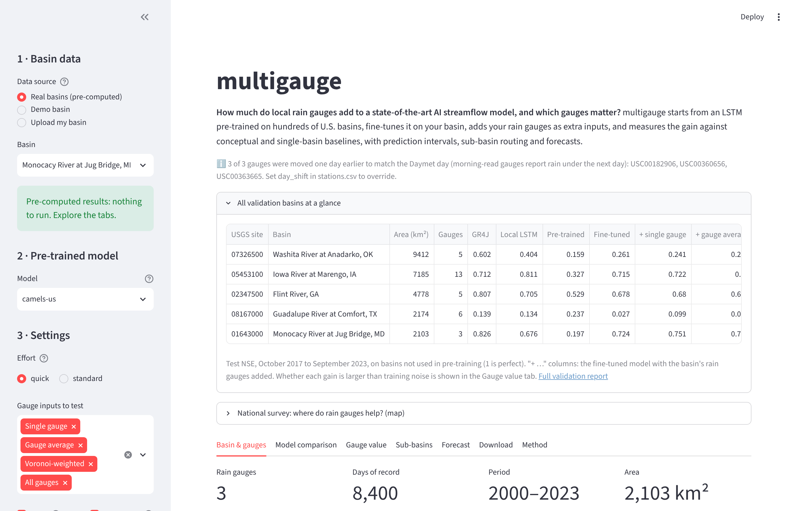
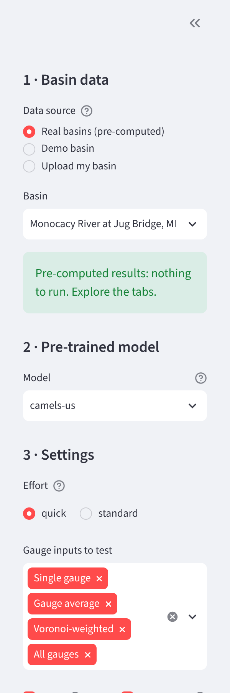
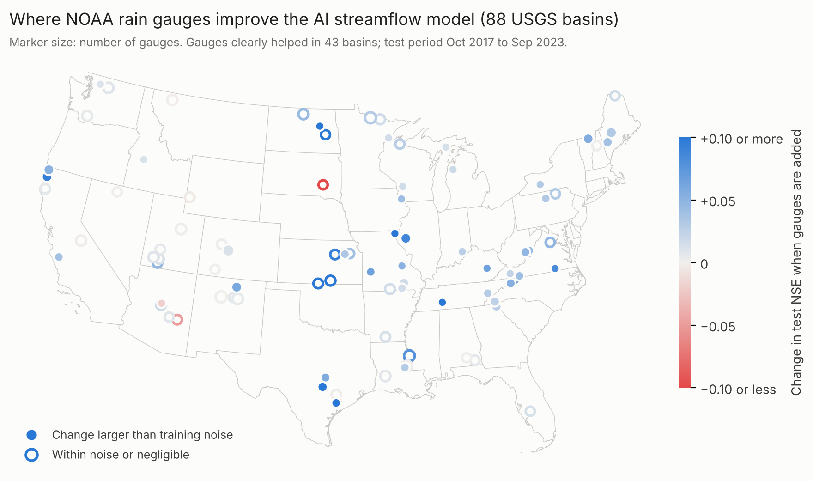
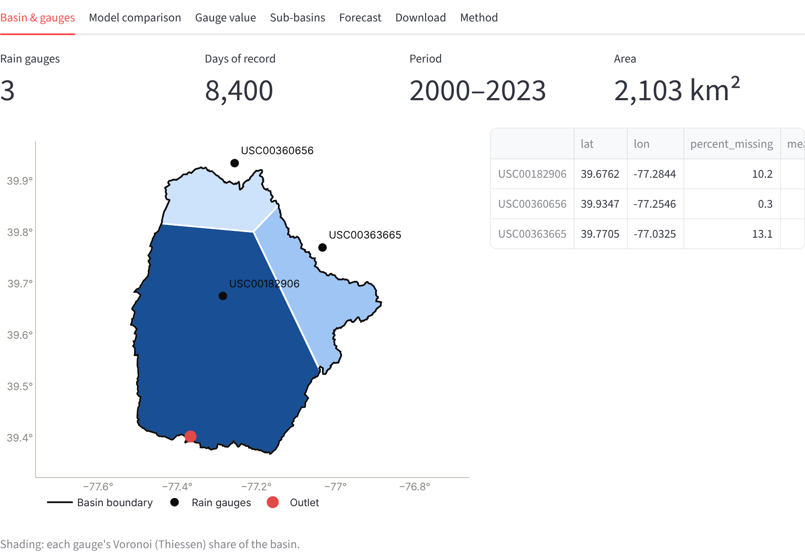
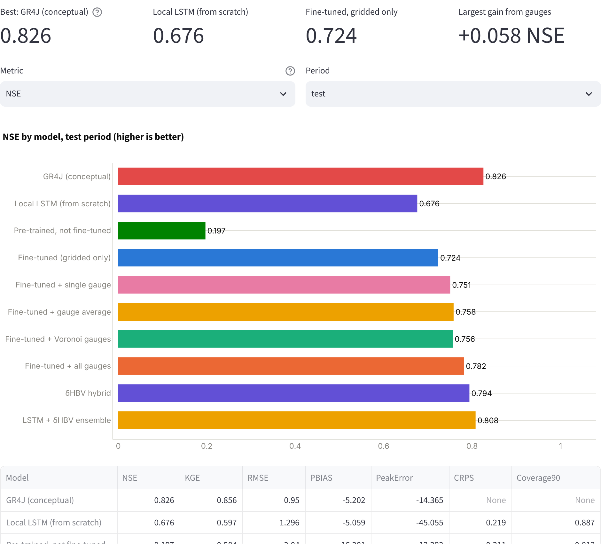
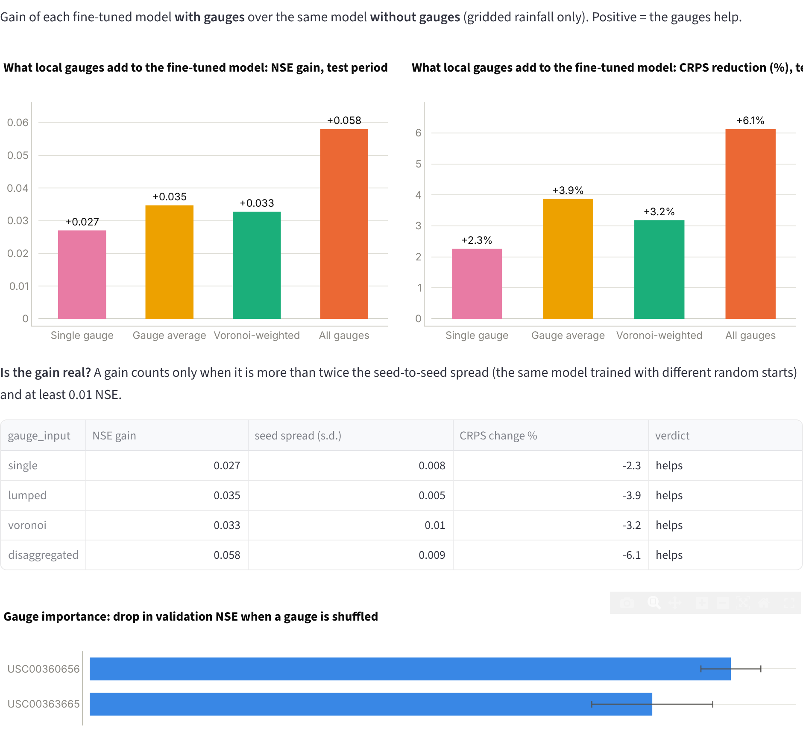
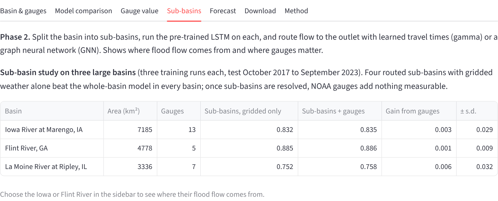
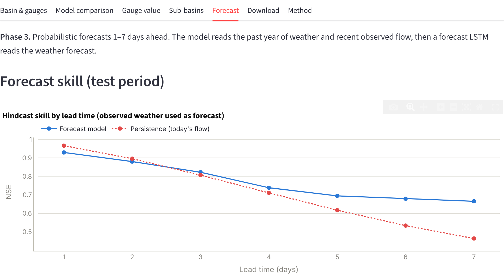

# multigauge user guide

This guide shows how to use the multigauge dashboard (https://multigauge-hydro.streamlit.app) and how to run a study for your own basin.

## 1. What the dashboard answers

For a river basin, multigauge asks: **if local rain gauges are added to a pre-trained AI streamflow model, how much do the predictions improve, and is the improvement real?** You can explore results already computed for U.S. basins, try a demo basin, or upload your own data.

## 2. Screen layout

The page has a **sidebar** on the left (choose data, model and settings) and the **results** on the right. At the top of the results are two summary panels: a table of all validation basins and the national survey map. Below them are tabs, one per part of the analysis.



## 3. Choose your data (sidebar)



1. **Data source.**
   - *Real basins (pre-computed)*: results already computed for U.S. basins the model never saw during training. Pick a basin from the list; results appear immediately and nothing needs to run.
   - *Demo basin*: a synthetic basin where the true rainfall is known. Use it to see a full run in a few minutes.
   - *Upload my basin*: run the study on your own files (see Section 6).
2. **Pre-trained model.** Use `camels-us` for real basins (trained on 531 U.S. basins). `demo-synthetic` is only for the demo basin.
3. **Settings** (only used when you run a study):
   - *Effort*: `quick` (one training run, a few minutes) or `standard` (three runs, so the dashboard can tell whether a gain is real).
   - *Gauge inputs to test*: single gauge, gauge average, Voronoi-weighted average, all gauges.
   - *GR4J* and *Local LSTM*: benchmark models to compare against.
   - *Station ablation*: retrain without each gauge in turn (slow).
4. Press **Run gauge-value study**. A progress bar shows each step. The button is disabled for pre-computed basins.

## 4. National survey

Open **National survey: where do rain gauges help?** to see 88 basins in all 18 U.S. hydrologic regions. Blue markers are basins where gauges raised the model's skill (NSE), red where they lowered it; filled markers are changes larger than training noise. Hover over a marker for the basin name and numbers.



## 5. The result tabs

**Basin & gauges.** The basin boundary, outlet and rain gauges, shaded by each gauge's Voronoi (Thiessen) share of the basin, with record length and missing data per gauge. A note above the tabs lists gauges whose day convention was corrected.



**Model comparison.** Skill of every model on the chosen metric (NSE, KGE, bias, peak error, CRPS, interval coverage) and period (train, validation, test), plus a table with all metrics. Higher NSE and KGE are better; lower CRPS is better.



**Gauge value.** The core result: the gain of each gauge input over the same model without gauges. The table gives the gain, its spread across training runs and a verdict — *helps*, *hurts*, *negligible* or *within noise*. The bottom chart ranks gauges by how much skill is lost when each one is shuffled.



**Sub-basins.** Results of splitting large basins into four routed sub-basins. For the Iowa and Flint Rivers, pick the basin in the sidebar to see how much of the flood flow comes from each sub-basin.



**Forecast.** Forecast skill 1–7 days ahead compared with persistence (assuming tomorrow's flow equals today's). The forecast model is useful where its line is above the persistence line. Available for the Iowa and Flint Rivers, or after running a forecast yourself.



**Download.** All results as a zip: metrics, daily predictions with prediction intervals, gauge rankings and a file recording every setting.

**Method**, **Technical paper** and **How to use.** A summary of the models, the full technical description with equations, and this guide.

## 6. Run your own basin

**Easiest — from a USGS gauge number (free GPU).** Open the *Run your basin* notebook
(https://colab.research.google.com/github/ogunbajoadeyinka/multigauge-hydro/blob/main/notebooks/run_your_basin.ipynb),
enter the 8-digit USGS site number and run all cells. It downloads the boundary, streamflow, Daymet weather and NOAA gauges, runs the study and saves a report.

**In the dashboard — your own files.** Choose *Upload my basin* and press *Download example files* to see the formats. Required files (CSV):

| File | Columns |
|---|---|
| Rain gauges | `date`, then one column per gauge (mm/day) |
| Gauge locations | `id`, `lat`, `lon` (decimal degrees); optional `day_shift` (−1, 0, +1) |
| Streamflow | `date`, `flow` (m³/s or ft³/s, choose the unit) |
| Gridded weather (Daymet) | `date`, `prcp`, `srad`, `tmax`, `tmin`, `vp` |

A basin boundary (GeoJSON or zipped shapefile, WGS84) is optional but recommended: it gives the area and the Voronoi weights. Your own gauge network — for example a state mesonet or city network — can be uploaded the same way. Uploaded files are processed in memory for your session only and are not stored. The free cloud server is slow; for anything beyond a quick test use the notebook.

**From Python or the command line.**

```python
# pip install -e ".[download]"   (from the repository folder)
from multigauge.prepare import prepare_usgs_basin
prepare_usgs_basin("01643000", "2000-10-01", "2023-09-30", "my_basin/")  # boundary, streamflow, Daymet and NOAA gauges for a USGS site
```

```bash
multigauge study my_basin/ --model camels-us --seeds 3   # run the study, write results and an HTML report
```

## 7. Reading the results

- **NSE** (Nash–Sutcliffe efficiency): 1 is perfect, 0 is no better than the mean flow. A gain of 0.02–0.05 is meaningful for a strong model.
- **A gain is real** only when it is more than twice its spread across training runs and at least 0.01. Use `standard` effort (three runs) before drawing conclusions for a single basin.
- **Gauges help most** in rain-dominated basins and where the model without gauges is weakest; they help little in snow-dominated basins.
- **NOAA gauges also feed the gridded data**, so their measured value is conservative; independent networks may add more.

## 8. Getting help

Report problems or ask questions on GitHub: https://github.com/ogunbajoadeyinka/multigauge-hydro/issues. Cite the software with its DOI, https://doi.org/10.5281/zenodo.23986756.
