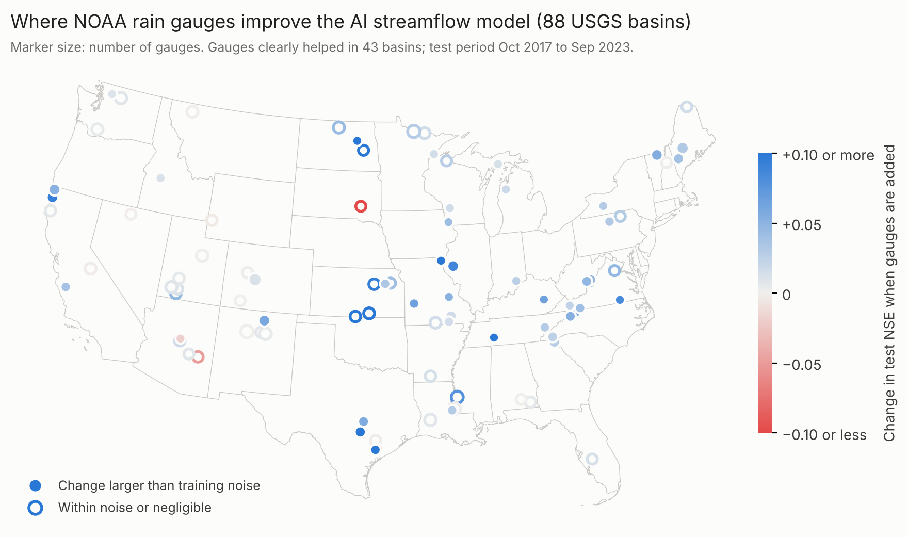

# Validation report: multigauge on five U.S. basins and an 88-basin national survey

*multigauge v0.2.1 · November 2026 · all numbers can be reproduced with
`python scripts/run_validation.py validation` (CPU, about 95 minutes per basin)
and explored on the [live dashboard](https://multigauge-hydro.streamlit.app) under "Real basins".*

## Question

Does adding local rain gauges improve a state-of-the-art, pre-trained AI streamflow model that already
uses gridded weather, and if so, where and how should the gauges be used?

## Set-up

| Item | Choice |
|---|---|
| Pre-trained model | LSTM (128 units, 365-day lookback, CMAL probabilistic head, NSE\* loss) trained on 531 CAMELS-US basins (October 1980 to September 1995, validated on 1995–2000), with Daymet inputs and 9 static attributes computed from the forcings |
| Hybrid | Differentiable HBV (δHBV) with LSTM-learned parameters, trained on the same basins |
| Validation basins | 5 USGS basins not in the training set, in 5 climates (table below); data from USGS, Daymet and NOAA GHCN-Daily, prepared automatically by `prepare_usgs_basin` |
| Periods | train 2001-10 to 2013-09 · validation 2013-10 to 2017-09 · **test 2017-10 to 2023-09** (all scores below are test scores) |
| Models compared | GR4J with snow (calibrated, differential evolution); LSTM trained from scratch on the basin; pre-trained LSTM without tuning; fine-tuned LSTM with gridded weather only; fine-tuned + gauges as a single gauge, gauge average, Voronoi-weighted average, or every gauge; δHBV; LSTM + δHBV ensemble |
| Gauge value | change in test NSE (and CRPS) of *fine-tuned + gauges* over *fine-tuned with gridded weather only*, same seeds and periods |
| Seeds | 3 per LSTM model. Gauge value is compared seed by seed; a gain counts as real when it exceeds twice its seed-to-seed spread and 0.01 NSE |

### CAMELS-US pre-training

On the standard held-out test years (October 2000 to September 2010) across the 531 basins: median NSE **0.68**,
median KGE 0.70, median CRPS 0.23 mm/day, 90 % interval coverage 0.91; 76 % of basins have NSE above
0.5. This is a little below the best published single LSTMs on the same benchmark (median NSE of
about 0.71–0.74; Kratzert et al., 2019), which use more static attributes than the nine computed here
from the forcings; the trade-off is that any U.S. basin can use the model without an attribute
database.

## Finding 1 — gauge timing must be checked first

Most NOAA cooperative observers read their gauge at about 7 am and record the total under that day,
so most of the rain fell the day before. Daymet corrects for this; the raw gauge records do not. In
the first run, gauges were used as downloaded:

| Basin | Gauge–Daymet correlation, as downloaded | after moving morning-read gauges one day earlier |
|---|---|---|
| Washita, OK | 0.61 | 0.92 |
| Iowa, IA | 0.27 | 0.98 |
| Flint, GA | 0.65 | 0.90 |
| Guadalupe, TX | 0.36 | 0.95 |
| Monocacy, MD | 0.27 | 0.90 |

(correlation of daily basin-average gauge rainfall with Daymet, 2000–2023)

multigauge now detects each gauge's day convention against Daymet and corrects it automatically
(airport ASOS gauges, which use calendar days, are correctly left alone), lists the shift per gauge
and lets users override it. Every result below uses aligned gauges. A model that receives
misaligned gauges sees rain a day *after* the streamflow responds; the gauge value it reports is
not meaningful, so this check matters for any study that adds station data to Daymet-driven
models.

## Finding 2 — model comparison (test NSE)

| Basin | Area (km²) | Gauges | GR4J | Local LSTM | Pre-trained | Fine-tuned | Best fine-tuned + gauges | δHBV | Ensemble |
|---|---|---|---|---|---|---|---|---|---|
| Washita River at Anadarko, OK | 9,412 | 5 | 0.602 | 0.404 | 0.159 | 0.261 | 0.241 (single) | **0.724** | 0.537 |
| Iowa River at Marengo, IA | 7,185 | 13 | 0.712 | **0.811** | 0.327 | 0.715 | 0.730 (average) | 0.718 | 0.774 |
| Flint River, GA | 4,778 | 5 | 0.807 | 0.705 | 0.529 | 0.678 | 0.684 (all) | **0.840** | 0.800 |
| Guadalupe River at Comfort, TX | 2,174 | 6 | 0.139 | 0.134 | **0.237** | 0.027 | 0.099 (single) | −0.014 | 0.091 |
| Monocacy River at Jug Bridge, MD | 2,103 | 3 | **0.826** | 0.676 | 0.197 | 0.724 | 0.782 (all) | 0.794 | 0.808 |

- **The pre-trained model does not transfer well without tuning to these basins** (NSE 0.16–0.53). All five
  are larger than any CAMELS training basin (the 531-basin set is limited to under 2,000 km²), so
  this is extrapolation in basin size. Fine-tuning recovers most of the gap.
- **No single model is best everywhere.** δHBV is best in the Washita and Flint, the local LSTM in Iowa,
  GR4J in the Monocacy. The LSTM + δHBV ensemble is never the worst and is within 0.04 of the best model
  in three of five basins, so it is a sensible default.
- **The Guadalupe defeats every model** (best NSE 0.24). It is a flashy Texas Hill Country river on karst,
  where rare storm floods dominate the test score and much of the flow comes from springs fed by
  groundwater beyond the surface catchment. Scores there should not be read as gauge value.
- **Calibrated GR4J remains a strong benchmark** in these large, partly semi-arid basins. Any claim that
  AI is better has to be tested basin by basin, which multigauge does by default.

## Finding 3 — the value of gauges depends on the basin and on the model structure

| Basin | NSE gain from gauges (best input) | Seed spread of the gain (s.d.) | CRPS change | Verdict |
|---|---|---|---|---|
| Monocacy, MD | **+0.058** (all gauges) | 0.009 | −6.1 % (better) | helps, for every gauge input |
| Iowa, IA | +0.015 (average) | 0.027 | −1.0 % | within noise |
| Flint, GA | +0.005 (all gauges) | 0.002 | −0.6 % | negligible |
| Guadalupe, TX | +0.072 (single) | 0.136 | +3.4 % (worse) | within noise; every model is poor here |
| Washita, OK — lumped | −0.020 (single) | 0.002 | −1.1 % | hurts, for every gauge input (−0.02 to −0.10) |
| Washita, OK — **sub-basins** | **+0.103** (routed 0.742 → routed + gauges 0.845) | — | — | clear gain |

The GHCN gauges used here are among the stations Daymet is interpolated from, so in a lumped model
they mostly repeat information the model already has. They help where the basin-average hides
spatial structure. The clearest example is the Washita split into four sub-basins
(LSTM per sub-basin, gamma unit-hydrograph routing):

| Washita model | Test NSE | KGE |
|---|---|---|
| One lumped LSTM (fine-tuned, gridded weather) | 0.214 | 0.543 |
| Four sub-basin LSTMs, routed | 0.742 | 0.807 |
| Four sub-basin LSTMs, routed, with each sub-basin's gauges | **0.845** | **0.902** |

The sub-basin model also shows where the flood water comes from: sub-basin Z1, the area nearest the
outlet, produces 54 % of peak flow and has **no gauge**, so it is the highest-priority location for a
new gauge. The three gauges in Z2 improve that sub-basin by 0.05 NSE; the one gauge in Z3 by 0.12.

**Implication.** Gauge networks that are *not* already in the gridded products, such as state mesonets,
city flood-warning networks or radar-based estimates, are where the method should show the most value.
Sub-basin modelling should be the default for basins well above the 2,000 km² training range.

## Finding 4 — forecasts (Washita, 1–7 days)

Hindcast/forecast LSTM with a per-lead error correction, tested on 2017–2023. Observed weather with
growing noise stands in for forecasts, so these numbers are an upper bound on skill with real
weather forecasts.

| Lead (days) | 1 | 2 | 3 | 4 | 5 | 6 | 7 |
|---|---|---|---|---|---|---|---|
| Forecast NSE | 0.680 | 0.591 | **0.616** | **0.629** | **0.632** | **0.632** | **0.638** |
| Persistence (today's flow) NSE | 0.893 | 0.676 | 0.472 | 0.319 | 0.215 | 0.145 | 0.090 |

The model beats persistence from day 3 onward, and its skill holds steady out to day 7 while
persistence collapses. For days 1–2, the current flow is still the better guide; blending the two is
planned.

## Finding 5 — national survey: gauges help most where rain, not snow, drives floods

The same study, in a lighter form (2 seeds; gauge average, Voronoi and all-gauge inputs; no local LSTM or
δHBV), was run on CAMELS basins drawn in turn from each of the 18 U.S. hydrologic regions
(`notebooks/national_kaggle.ipynb`, Kaggle GPU, two runs totalling about 9 hours). All data are public (USGS,
Daymet, NOAA GHCN-Daily). **88 basins in all 18 regions** finished: 5 in each region except the Rio Grande and
the Great Basin (4 each). 69 basins used the standard gauge search (gauges inside the basin or within 5 km,
records covering 80 % of the years); in regions still short of basins, 19 more used a fill-in search (within
25 km, 60 % of years, basins up to 10,000 km²). Of the candidates skipped, 119 had too few usable NOAA gauges
even then, 4 had streamflow records that did not cover the test period, and 1 had no basin boundary in the
USGS index. 64 of the 88 basins are in the pre-training set (their training years, 1980–1995, do not overlap
the 2017–2023 test). Results per basin are in `validation/national/`.



| | All 88 basins |
|---|---|
| Median test NSE: GR4J / pre-trained (no tuning) / fine-tuned / fine-tuned + all gauges | 0.703 / 0.397 / 0.728 / **0.772** |
| Basins where adding every gauge as an input raised NSE | **80 %** (70 of 88); Wilcoxon signed-rank p = 3 × 10⁻⁹ |
| Median NSE gain, all gauges as inputs (fixed choice) | **+0.021** (mean +0.036) |
| Median NSE gain, gauge average | +0.011 (positive in 76 %) |
| Per-basin verdicts, best input (2 seeds) | helps 43 · within noise 37 · negligible 6 · hurts 2 |
| Basins with at least one morning-read gauge moved one day | 83 % |

**Where gauges help** (gain with all gauges as inputs):

| Basin type | Basins | Median gain | Gain positive in | Median NSE without gauges |
|---|---|---|---|---|
| Rain-dominated (snow < 10 % of precipitation) | 43 | **+0.039** | 93 % | 0.61 |
| Mixed (10–30 % snow) | 28 | +0.017 | 82 % | 0.74 |
| Snow-dominated (> 30 % snow) | 17 | −0.001 | 41 % | 0.83 |

- **Gauges add skill in most U.S. basins, even though NOAA gauges also feed Daymet.** The gain is small
  (+0.02 to +0.04 NSE) but consistent across the country, and this pooled test does not depend on the noisy
  per-basin seed spread.
- **The value is concentrated in rain-dominated basins** (the East, the Midwest, Texas, the northern Plains,
  California's coastal ranges), where short storms are poorly represented in gridded data. In snow-dominated
  western basins the model is already accurate (median NSE 0.83) and flow follows the snowpack, so gauges add
  nothing (Spearman correlation of gain with snow fraction −0.40, p = 1 × 10⁻⁴). Regional medians range from
  +0.057 (Texas-Gulf) and +0.051 (Upper Mississippi) to about zero in the Great Basin, Rio Grande and Upper
  Colorado.
- **Gauges help most where the model is weakest** (correlation of gain with the no-gauge NSE −0.45,
  p < 10⁻⁴).
- **Basin size, gauge count, gauge density and aridity did not predict the gain** (|ρ| ≤ 0.15, p ≥ 0.17),
  which argues against simple density rules for network design.
- **Gauges found by the wider fill-in search still helped** (positive in 79 % of those 19 basins, median
  +0.013, against +0.023 for the standard search).
- **The AI model is not automatically better than a calibrated conceptual model.** Fine-tuned without gauges it
  beat GR4J in 50 % of basins (56 % with gauges). Its advantage is consistency and transfer; GR4J remains a
  necessary benchmark.
- **The timing check matters nationally:** 83 % of basins had at least one gauge on the morning-read convention.

## Limitations

- Five detailed basins and an 88-basin survey; the survey uses 2 seeds per basin, so individual basin verdicts
  are uncertain, and only the pooled national results should be read as general.
- The survey is limited to basins with at least two long-record NOAA gauges; in sparsely gauged regions this
  needed a wider (25 km) search, and the Rio Grande and Great Basin have four basins each.
- In the first, misaligned run the Guadalupe appeared to gain +0.27 NSE from gauges. With aligned gauges
  and the seed spread taken into account, that gain is not there: a reminder to read gauge value
  against seed noise, as the report and dashboard now show.
- All five basins are larger than the training basins. Pre-training on a set that includes larger
  basins (e.g. CAMELS-US 671, Caravan) should narrow the gap between the zero-shot and fine-tuned models.
- The Washita validation period (2013–2017) contains the record May 2015 floods; validation NSE is
  therefore low for every model there, and early stopping is driven by that event.
- Gauges come from NOAA GHCN, which overlaps the gauges used to build Daymet. Independent networks
  (state mesonets, radar-adjusted products) are needed to measure the full value of local gauges.
- Forecast skill uses perturbed observations, not archived forecasts.
- Gauge value is measured on one train/validation/test split; three seeds bound the training noise
  but not the period sensitivity.

## Reproduce

```bash
pip install -e ".[download]"
python -c "from multigauge.prepare import prepare_usgs_basin as p; p('01643000','2000-10-01','2023-09-30','validation/01643000/data')"
python scripts/run_validation.py validation 01643000
```

The basin folders used here are in `validation/<site>/data`, and the results (metrics per seed,
predictions, gauge value, station tables and an HTML report) are in `validation/<site>/results`.
